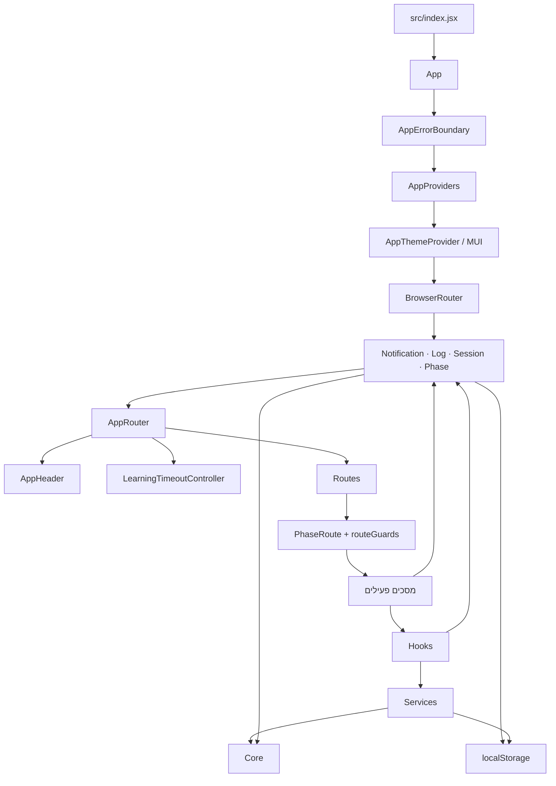

# ארכיטקטורת המערכת

> **סטטוס:** תיאור המימוש הנוכחי, לא יעד עתידי. מקור אמת למסכים הפעילים הוא `APP_ROUTES`.

## מטרת המערכת

Burrito היא אפליקציית React להדגמת זרימת למידה ולתיעוד פעולות המשתתפים. הממשק מציג בוחן מקדים, אחד משני מסלולי למידה (קלאסי או רנאטו סאיג), בוחן העברה ולוח חוקר. האפליקציה היא צד־לקוח בלבד: מצב הסשן והלוגים נשמרים בדפדפן, ואין שרת יישומים או מסד נתונים מרכזי.

## מבט כללי

נקודת הכניסה היא [`src/index.jsx`](../src/index.jsx). היא יוצרת את React root, טוענת את גיליון הסגנונות הגלובלי ומרנדרת את [`src/app/App.jsx`](../src/app/App.jsx). `App` מחבר בין גבול השגיאות, ספקי האפליקציה והראוטר.

### מפת התמצאות בקוד

| אם רוצים להבין… | כדאי להתחיל ב… |
|---|---|
| אילו מסכים זמינים ובאילו כתובות | [`src/app/routeConfig.js`](../src/app/routeConfig.js), [`src/core/constants/routes.js`](../src/core/constants/routes.js) |
| למה כתובת מסוימת מנותבת למסך אחר | [`src/app/PhaseRoute.jsx`](../src/app/PhaseRoute.jsx), [`src/app/routeGuards.js`](../src/app/routeGuards.js) |
| איך סשן משתתף מעודכן ונשמר | [`src/context/SessionContext.jsx`](../src/context/SessionContext.jsx), [`src/core/session/sessionState.js`](../src/core/session/sessionState.js), [`src/services/SessionStorage.js`](../src/services/SessionStorage.js) |
| איך אירועים נרשמים ומיוצאים | [`src/context/LogContext.jsx`](../src/context/LogContext.jsx), [`src/hooks/useLogger.js`](../src/hooks/useLogger.js), [`src/services/ExportService.js`](../src/services/ExportService.js) |
| איך משותפים שלבי הלמידה בין המסלולים | [`src/core/constants/functionStudy.js`](../src/core/constants/functionStudy.js), [`src/components/study/`](../src/components/study/) |
| איך נראית הזרימה מקצה לקצה | [`tests/flow.test.jsx`](../tests/flow.test.jsx), [`README.md`](../README.md) |

## שכבות ואחריות

| שכבה | מיקום | אחריות |
|---|---|---|
| אתחול והרכבה | `src/index.jsx`, `src/app/` | יצירת האפליקציה, הגדרת React Router, מיפוי כתובות למסכים, guards, והפעלת בקרת מגבלת זמן. |
| ממשק | `src/components/` | מסכים, תצוגות ורכיבים לשימוש חוזר. `components/screens/` מחבר בין מצב האפליקציה לתצוגות התחום; תיקיות כמו `assessment/`, `study/`, `classic/` ו־`transfer/` מכילות רכיבי ממשק ממוקדים. |
| תיאום פעולות | `src/hooks/` | ממשקי שימוש חוזרים לפעולות כגון ניווט, רישום לוגים, טיימרים, רמזים וייצוא. |
| מצב אפליקציה | `src/context/` | ספקי מצב עבור סשן, שלב נוכחי, לוגים והודעות. ה־contexts מחברים את רכיבי React ללוגיקת התחום ולשמירה. |
| לוגיקה ונתונים | `src/core/` | טיפוסים קבועים, מפת שלבים ונתיבים, תוכן לימודי, מבנה מצב הסשן, reducer וכלי עזר ללא תלות בתצוגה. |
| שירותים | `src/services/` | הקצאת מסלול, שמירת/טעינת סשן, זיהוי קושי, אנליטיקת לוגים, ניקוד וייצוא. |
| עיצוב | `src/styles/`, `src/theme/` | CSS גלובלי אחראי לפריסת הממשק; ערכת MUI מגדירה כיוון RTL, צבעים וטיפוגרפיה ותואמת לעיצוב הקיים. |

### כיווני תלות

- `App` מרכיב providers וראוטר; הוא אינו אמור להכיל לוגיקה של מסך ספציפי.
- `components/screens/` מחבר את התנהגות השלב ל־contexts ול־hooks; רכיבים בתוך תיקיות התחום מיועדים להרכבה ושימוש חוזר.
- `hooks/` מרכזים פעולות React חוזרות, אך חישובי תחום נשארים בשירותים או ב־`core/` כדי שיהיה אפשר לבדוק אותם בנפרד מהממשק.
- `core/` מחזיק קבועים ומודל מצב; הוא לא אמור להיות תלוי ברכיבי תצוגה.
- שינוי בנתיב פעיל צריך להירשם ב־`routeConfig.js`; `screenRegistry.js` הוא ייצוא תאימות בלבד.

## זרימת האפליקציה והניווט

המקור המרכזי להגדרת המסכים הפעילים הוא [`src/app/routeConfig.js`](../src/app/routeConfig.js). [`src/app/AppRouter.jsx`](../src/app/AppRouter.jsx) יוצר מהם את ה־React routes ומטפל בכתובת הבית ובכתובות לא מוכרות. מפת השלב־לכתובת נמצאת ב־[`src/core/constants/routes.js`](../src/core/constants/routes.js). `screenRegistry.js` נשאר כייצוא תאימות שמפנה ל־registry הזה, ולא כמקום נוסף להגדרת routes.

המסלול הרגיל הוא:

1. **כניסה** (`/login`) — נוצר סשן משתתף או חוקר.
2. **בוחן מקדים** (`/pre-test`) — תשובות המשתתף נשמרות; בהגשה נשמרת הקצאת המסלול ומתחיל טיימר הלמידה.
3. **למידה** — אחד משני מסלולים בני חמישה שלבים: קלאסי (`/activities/classic/...`) או רנאטו (`/renato/...`). לשניהם מטרות לימודיות, שאלות וכלי שרטוט משותפים, עם הבדלים בדרך הצגת משימות העיבוד.
4. **בוחן העברה** (`/transfer-test`) — מוצג לאחר סיום הלמידה או תום מגבלת הזמן. `PhaseRoute` ו־`routeGuards.js` מונעים דילוג לא מורשה; מעבר פנימי מסיום הלמידה מסומן בניתוב.
5. **סיום** (`/complete`) — מוצג לאחר הגשת בוחן ההעברה.
6. **לוח חוקר** (`/researcher`) — צפייה בלוגים, סיכומים וניקוד ידני, וכן ייצוא נתונים.

`PhaseProvider` מסנכרן בין הכתובת לבין השלב הנוכחי, שומר את השלב בדפדפן ומספק פעולות ניווט. `usePhaseNavigation` מרכז מעברים שמייצרים אירועי לוג. `LearningTimeoutController` עוקב אחר 30 דקות הלמידה ומעביר לבוחן ההעברה בתום הזמן.

### מחזור חיים של נתונים ואירועים

| פעולה | עדכון מצב/ניווט | אירועים עיקריים |
|---|---|---|
| פתיחת בוחן מקדים | `PreAssessmentScreen` קורא ועורך את `session.preAssessment` | `pre_assessment_start`, `edit` |
| הגשת בוחן מקדים | הקצאת מסלול, קביעת `learningStartedAt` וניווט לשלב הלמידה | `pre_assessment_submit`, `activity_start`, `learning_start` |
| עבודה במסלול | שמירת תשובות, משימות עיבוד וגרף בסשן | `edit`, `phase_change`, פעולות כלי לפי הצורך |
| סיום או timeout | קביעת `learningEndedAt` וניווט לבוחן ההעברה | `activity_complete` או `time_limit_reached`, ואז `learning_complete` |
| הגשת בוחן העברה | שמירת תשובות והתקדמות למסך הסיום | `transfer_assessment_start`, `edit`, `transfer_submit` |
| ניקוד/ייצוא חוקר | נתוני ניקוד מתווספים להיסטוריית האירועים; הייצוא נגזר מהלוגים | `assessment_score` |

אירוע לוג כולל מזהה, חותמת זמן, סוג פעולה, payload בשדה `data` ו־`skill` אופציונלי. `useLogger` מוסיף את מזהה המשתתף, הסשן והמסלול; לכן מומלץ להשתמש בו ברכיבי מסך במקום לקרוא ל־`addLog` ישירות, למעט תהליכים מערכתיים שמנהלים לוג במפורש.

### נתיבים וכללי גישה

| שלב | נתיב או תבנית | מסך |
|---|---|---|
| כניסה ובוחן מקדים | `/login`, `/pre-test` | `LoginScreen`, `PreAssessmentScreen` |
| מסלול קלאסי — לפי סדר הלמידה | `/activities/classic` → `/activities/classic/extrema` → `/activities/classic/asymptotes` → `/activities/classic/intercepts` → `/activities/classic/graph` | `ClassicScreen` ותתי־המסכים שלו |
| מסלול רנאטו — לפי סדר הלמידה | `/renato/domain` → `/renato/extrema` → `/renato/asymptotes` → `/renato/intercepts` → `/renato/graph` | `RenatoScreen` ותתי־המסכים שלו |
| בוחן העברה וסיום | `/transfer-test`, `/complete` | `TransferAssessmentScreen`, `CompletionScreen` |
| חוקר | `/researcher` | `ResearcherDashboard` |

`/renato` הוא נתיב תאימות שמפנה אל `/renato/domain`; הוא אינו שלב נוסף.

ה־guards בודקים את קיום הסשן, מצב החוקר, התחלת/סיום הלמידה, מגבלת הזמן, המסלול שהוקצה והגשת בוחן ההעברה. לדוגמה, פתיחה ישירה של בוחן ההעברה אינה עוקפת את הזרימה: לפני למידה המשתתף יופנה לבוחן המקדים, במהלך למידה למסלול שלו, וכניסה ישירה לאחר סיום תנותב לכניסה. המעבר מתוך הזרימה מסומן ב־React Router state.

בעת שינוי כתובת `PhaseProvider` מעדכן את השלב ומוסיף אירוע `phase_change`. `usePhaseNavigation` הוא שער הניווט של רכיבי הממשק; סיום הלמידה מתועד לפני המעבר לבוחן ההעברה.

## מצב, לוגים ושמירה

`SessionContext` משתמש ב־`sessionReducer` שב־[`src/core/session/sessionState.js`](../src/core/session/sessionState.js) כדי לעדכן סשן באופן מרוכז: פרטי משתתף, המסלול, תשובות, תשובות עבודה, מצב הגרף, נתוני הבוחנים וזמני התחלה וסיום. `SessionStorage` טוען ושומר את הסשן ב־`localStorage` תחת `ctAdapt.session`.

`LogContext` מנהל רצף אירועים עם חותמות זמן ומזהי סשן, ושומר אותו תחת `ctAdapt.logs`. `useLogger` מצרף לאירועים את פרטי הסשן הנוכחי. שירותי האנליטיקה, הניקוד והייצוא צורכים את הלוגים; [`src/services/ExportService.js`](../src/services/ExportService.js) מייצר קובצי JSON ו־CSV. שלב הניווט נשמר תחת `ctAdapt.phase`, ונתוני הקצאת מסלול תחת `ctAdapt.allocation`.

כל הנתונים נשארים בדפדפן המקומי: אין שרת, גיבוי מרכזי או סנכרון בין מכשירים. אין גם אימות משתמשים; מצבי "משתתף" ו"חוקר" הם מצבי ממשק, לא גבול אבטחה. ניקוי נתוני האתר עשוי למחוק את המידע. המערכת היא הדגמה ולא תשתית לאיסוף נתוני מחקר.

### מפת מצב ואחסון

| מידע | בעלים בזמן ריצה | מפתח `localStorage` | שימוש עיקרי |
|---|---|---|---|
| סשן נוכחי ותשובות | `SessionContext` + `sessionReducer` | `ctAdapt.session` | שחזור עבודה, מסלול, תשובות וזמני למידה. |
| יומן אירועים מצטבר | `LogContext` | `ctAdapt.logs` | תיעוד פעולות, ניתוח, ניקוד וייצוא. |
| שלב אחרון | `PhaseContext` | `ctAdapt.phase` | שחזור מיקום המשתתף בזרימה. |
| הקצאות משתתפים | `StudyAllocationService` | `ctAdapt.allocation` | מניעת הקצאה חוזרת ושמירת מסלול שנבחר/הוקצה. |

העדכון נעשה קודם בזיכרון React; providers ושירותים שומרים ל־`localStorage`. זהו מנגנון התמדה מקומי, לא שכבת אמינות. האפליקציה אינה מאזינה לשינויי `storage` מטאבים אחרים, ולכן מצב React לא מתעדכן בהם בזמן אמת. יש לייצא נתונים חשובים לפני ניקוי הדפדפן.

### תחומי אחריות של הספקים

| Provider | אחריות |
|---|---|
| `NotificationProvider` | הודעות זמניות למשתמש. |
| `LogProvider` | רשימת אירועים, הוספה, קריאה ושמירה של הלוגים. |
| `SessionProvider` | סשן המשתתף ופעולות ה־reducer. |
| `PhaseProvider` | שלב נוכחי, היסטוריה וניווט שמסונכרנים עם React Router. |

### שירותים מרכזיים

| שירות | אחריות |
|---|---|
| `StudyAllocationService` | שמירת בחירת המשתתף או הקצאה דמוית בלוקים אקראיים. `AUTO_ASSIGN_STUDY_PATH` כבוי כרגע, לכן ברירת המחדל היא בחירה ידנית. |
| `LogAnalyticsService` | חישוב סיכומי סשן, משכי שלבים ומעורבות בכלים מתוך אירועי הלוג. |
| `AssessmentScoringService` | ניהול רשומות ניקוד ידני לבוחנים. |
| `ExportService` | המרת לוגים וסיכומים ל־JSON/CSV והורדתם בדפדפן. |
| `DifficultyDetectionService` | זיהוי קושי לפי כללים ומדדי התקדמות; נמצא בקוד, אך אינו חלק מנתיבי הלמידה הפעילים המוגדרים כרגע. |

## מסכים פעילים ורכיבים ותיקים

המסכים המוגדרים ב־`APP_ROUTES` הם המסכים הפעילים של הזרימה הנוכחית. קבצים כגון `AnalogScreen`, `DifficultyScreen`, `ProblemScreen`, `ReturnScreen`, `SolvingScreen`, `EffortScreen` ו־`TransferScreen` עדיין קיימים בקוד, אך אינם רשומים כרגע כנתיבים פעילים. גם ערכי `Phase` וקיצורי ניווט מסוימים נשארו עבור הזרימה האדפטיבית הישנה; אין להסיק מעצם קיומם שהם חלק מהמסלול הנוכחי.

`src/components/screens/FunctionStudyStep.jsx` הוא קובץ facade שמייצא מחדש רכיבי לימוד מתוך `src/components/study/`. כך מסכי קלאסי ורנאטו יכולים להשתמש באותו רכיב שלב בלי לשכפל את מימוש התצוגה.

## הרחבת הזרימה

להוספת שלב פעיל:

1. להגדיר את ערך השלב ב־`src/core/types/enums.js` ואת הכתובת ב־`src/core/constants/routes.js`.
2. לרשום את המסך פעם אחת ב־`src/app/routeConfig.js` ולעדכן את רצף המעבר ב־`src/core/constants/phases.js`.
3. להוסיף כללי גישה או הפניה ב־`src/app/routeGuards.js` רק אם השלב דורש אותם.
4. אם נדרש מידע חדש בסשן, לעדכן את המצב ההתחלתי, הנרמול וה־reducer ב־`src/core/session/sessionState.js`, ולחשוף פעולת עדכון דרך `SessionContext`.
5. לתעד פעולות חדשות דרך `useLogger`; אם הן צריכות להופיע באנליטיקה או בייצוא, לעדכן גם את השירות הרלוונטי.
6. להוסיף בדיקת שירות/ניתוב או בדיקת זרימה תחת `tests/` לפי סוג השינוי.

עיקרון מנחה: הגדרות של תוכן לימודי שייכות ל־`core/constants`, לוגיקה עסקית לשירותים או ל־`core`, state משותף ל־contexts, וממשק לרכיבי התחום. אין להוסיף route פעיל רק מפני שקיים ערך `Phase` או קובץ מסך.

## בדיקות

| קובץ | כיסוי עיקרי |
|---|---|
| [`tests/routing.test.js`](../tests/routing.test.js) | מיפוי שלבים לכתובות וסדר המעברים. |
| [`tests/session-state.test.js`](../tests/session-state.test.js) | מצב התחלתי, נרמול ושינויי מצב של סשן. |
| [`tests/study-allocation.test.js`](../tests/study-allocation.test.js) | בחירת מסלול, הקצאה ומניעת כפילויות. |
| [`tests/services.test.js`](../tests/services.test.js) | שירותי תחום, אנליטיקה וחישובים. |
| [`tests/flow.test.jsx`](../tests/flow.test.jsx) | תרחישי משתמש מלאים ב־React Testing Library. |

ההרצה וה־build מוגדרים ב־[`package.json`](../package.json); סביבת Vitest נמצאת ב־[`vitest.config.js`](../vitest.config.js).
