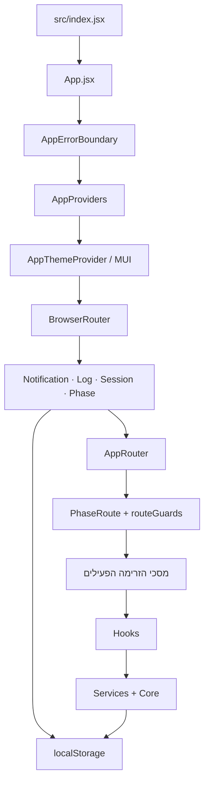

# ארכיטקטורת המערכת

## מטרת המערכת

Burrito היא אפליקציית React להדגמת זרימת למידה ולתיעוד פעולות המשתתפים. הממשק מציג בוחן מקדים, אחד משני מסלולי למידה (קלאסי או רנאטו סאיג), בוחן העברה ולוח חוקר. האפליקציה היא צד־לקוח בלבד: מצב הסשן והלוגים נשמרים בדפדפן, ואין שרת יישומים או מסד נתונים מרכזי.

## מבט כללי

נקודת הכניסה היא [`src/index.jsx`](../src/index.jsx). היא יוצרת את React root, טוענת את גיליון הסגנונות הגלובלי ומרנדרת את [`src/app/App.jsx`](../src/app/App.jsx). `App` מחבר בין גבול השגיאות, ספקי האפליקציה והראוטר.

## שכבות ואחריות

| שכבה | מיקום | אחריות |
|---|---|---|
| אתחול והרכבה | `src/index.jsx`, `src/app/` | יצירת האפליקציה, הגדרת React Router, מיפוי כתובות למסכים, guards, והפעלת בקרת מגבלת זמן. |
| ממשק | `src/components/` | מסכים, תצוגות ורכיבים לשימוש חוזר. `components/screens/` מחבר בין מצב האפליקציה לתצוגות התחום; תיקיות כמו `assessment/`, `study/`, `classic/` ו־`transfer/` מכילות רכיבי ממשק ממוקדים. |
| תיאום פעולות | `src/hooks/` | ממשקי שימוש חוזרים לפעולות כגון ניווט, רישום לוגים, טיימרים, רמזים וייצוא. |
| מצב אפליקציה | `src/context/` | ספקי מצב עבור סשן, שלב נוכחי, לוגים והודעות. ה־contexts מחברים את רכיבי React ללוגיקת התחום ולשמירה. |
| לוגיקה ונתונים | `src/core/` | טיפוסים קבועים, מפת שלבים ונתיבים, תוכן לימודי, מבנה מצב הסשן, reducer וכלי עזר ללא תלות בתצוגה. |
| שירותים | `src/services/` | הקצאת מסלול, שמירת/טעינת סשן, זיהוי קושי, אנליטיקת לוגים, ניקוד וייצוא. |
| עיצוב | `src/styles/`, `src/theme/` | CSS גלובלי אחראי לפריסת הממשק; ערכת MUI מגדירה כיוון RTL, צבעים וטיפוגרפיה ותואמת לעיצוב הקיים. |

## זרימת האפליקציה והניווט

המקור המרכזי להגדרת המסכים הפעילים הוא [`src/app/routeConfig.js`](../src/app/routeConfig.js). [`src/app/AppRouter.jsx`](../src/app/AppRouter.jsx) יוצר מהם את ה־React routes ומטפל בכתובת הבית ובכתובות לא מוכרות. מפת השלב־לכתובת נמצאת ב־[`src/core/constants/routes.js`](../src/core/constants/routes.js). `screenRegistry.js` נשאר כייצוא תאימות שמפנה ל־registry הזה, ולא כמקום נוסף להגדרת routes.

המסלול הרגיל הוא:

1. **כניסה** (`/login`) — נוצר סשן משתתף או חוקר.
2. **בוחן מקדים** (`/pre-test`) — תשובות המשתתף נשמרות; בהגשה נשמרת הקצאת המסלול ומתחיל טיימר הלמידה.
3. **למידה** — אחד משני מסלולים בני חמישה שלבים: קלאסי (`/activities/classic/...`) או רנאטו (`/renato/...`). לשניהם מטרות לימודיות, שאלות וכלי שרטוט משותפים, עם הבדלים בדרך הצגת משימות העיבוד.
4. **בוחן העברה** (`/transfer-test`) — מוצג לאחר סיום הלמידה או תום מגבלת הזמן. `PhaseRoute` ו־`routeGuards.js` מונעים דילוג לא מורשה; מעבר פנימי מסיום הלמידה מסומן בניתוב.
5. **סיום** (`/complete`) — מוצג לאחר הגשת בוחן ההעברה.
6. **לוח חוקר** (`/researcher`) — צפייה בלוגים, סיכומים וניקוד ידני, וכן ייצוא נתונים.

`PhaseProvider` מסנכרן בין הכתובת לבין השלב הנוכחי, שומר את השלב בדפדפן ומספק פעולות ניווט. `usePhaseNavigation` מרכז מעברים שמייצרים אירועי לוג. `LearningTimeoutController` עוקב אחר 30 דקות הלמידה ומעביר לבוחן ההעברה בתום הזמן.

## מצב, לוגים ושמירה

`SessionContext` משתמש ב־`sessionReducer` שב־[`src/core/session/sessionState.js`](../src/core/session/sessionState.js) כדי לעדכן סשן באופן מרוכז: פרטי משתתף, המסלול, תשובות, תשובות עבודה, מצב הגרף, נתוני הבוחנים וזמני התחלה וסיום. `SessionStorage` טוען ושומר את הסשן ב־`localStorage` תחת `ctAdapt.session`.

`LogContext` מנהל רצף אירועים עם חותמות זמן ומזהי סשן, ושומר אותו תחת `ctAdapt.logs`. `useLogger` מצרף לאירועים את פרטי הסשן הנוכחי. שירותי האנליטיקה, הניקוד והייצוא צורכים את הלוגים; [`src/services/ExportService.js`](../src/services/ExportService.js) מייצר קובצי JSON ו־CSV. שלב הניווט נשמר תחת `ctAdapt.phase`, ונתוני הקצאת מסלול תחת `ctAdapt.allocation`.

כל הנתונים נשארים בדפדפן המקומי. לכן הם אינם מסונכרנים בין מכשירים, וניקוי נתוני האתר עשוי למחוק אותם. המערכת היא הדגמה ולא תשתית לאיסוף נתוני מחקר.

## מסכים פעילים ורכיבים ותיקים

המסכים המוגדרים ב־`APP_ROUTES` הם המסכים הפעילים של הזרימה הנוכחית. קבצים כגון `AnalogScreen`, `DifficultyScreen`, `ProblemScreen`, `ReturnScreen`, `SolvingScreen`, `EffortScreen` ו־`TransferScreen` עדיין קיימים בקוד, אך אינם רשומים כרגע כנתיבים פעילים. גם ערכי `Phase` וקיצורי ניווט מסוימים נשארו עבור הזרימה האדפטיבית הישנה; אין להסיק מעצם קיומם שהם חלק מהמסלול הנוכחי.

`src/components/screens/FunctionStudyStep.jsx` הוא קובץ facade שמייצא מחדש רכיבי לימוד מתוך `src/components/study/`. כך מסכי קלאסי ורנאטו יכולים להשתמש באותו רכיב שלב בלי לשכפל את מימוש התצוגה.

## הרחבת הזרימה

להוספת שלב פעיל יש לעדכן את הגדרת השלב ואת הנתיב ב־`src/core/types/enums.js` וב־`src/core/constants/routes.js`, לרשום את המסך ב־`src/app/routeConfig.js`, ולעדכן את רצף המעבר ב־`src/core/constants/phases.js`. אם השלב דורש כללי הרשאה או הפניה מיוחדים, יש להוסיף אותם ל־`src/app/routeGuards.js`. מידע חדש שצריך להישמר בסשן שייך למודל ול־reducer שב־`src/core/session/sessionState.js`; רכיבי המסך צריכים להשתמש ב־contexts וב־hooks במקום לנהל שמירה נפרדת.

## בדיקות

בדיקות Vitest נמצאות תחת `tests/`: בדיקות שירותים וחישובים, מצב סשן והקצאה, ניתוב, ובדיקות זרימה של React עם Testing Library. סביבת הבדיקות מוגדרת ב־[`vitest.config.js`](../vitest.config.js).
